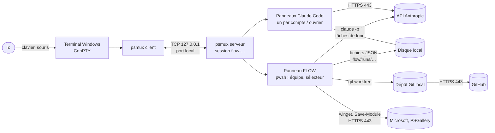

# Modèle OSI de FLOW

FLOW n'est pas un protocole réseau : c'est une application qui fait **circuler des échanges** entre toi, des programmes locaux (psmux, Claude Code, Git) et quelques services sur Internet (Anthropic, GitHub, Microsoft, PowerShell Gallery). Ce document projette ces échanges sur les **7 couches du modèle OSI** : ce que chaque couche porte dans FLOW, avec quel protocole, et où le code s'en occupe.

Deux plans coexistent :

- **le plan local** : tout ce qui se passe sur ton PC (terminal, psmux, processus, fichiers) ;
- **le plan Internet** : ce qui sort de ton PC (Claude Code → API, Git → GitHub, winget, téléchargement de Pester).

> Les couches 1 à 3 (physique, liaison, réseau) ne sont pas gérées par FLOW : elles sont fournies par Windows, ta carte réseau et ta box. Elles figurent ici pour que le parcours soit complet.

## 1. Vue d'ensemble

## 2. Les 7 couches appliquées à FLOW

| # | Couche OSI | Rôle général | Dans FLOW — plan local | Dans FLOW — plan Internet |
|---|---|---|---|---|
| 7 | **Application** | protocoles utilisés par les programmes | FLOW lui-même (sélecteur, fenêtre Équipe, écran Mémoire) ; commandes `psmux`, `git`, `claude` ; prompts écrits dans des fichiers puis donnés à `claude -p` | HTTP(S) vers l'API de Claude Code ; protocole « smart HTTP » de Git vers GitHub ; API REST de GitHub (`gh`, publication des versions) ; sources de winget et de PowerShell Gallery |
| 6 | **Présentation** | format, codage, chiffrement des données | **UTF-8** (tout le texte) ; **JSON** (`state.json`, plans, `dependances.json`) et **JSON Lines** (`echanges.jsonl`, `evenements.jsonl`) ; **séquences VT/ANSI** (couleurs, curseur, souris SGR) ; **Markdown** (comptes-rendus, profil) ; masquage des secrets (`Redact-Text`) | **TLS** : chiffrement des échanges HTTPS ; JSON des requêtes et réponses de l'API |
| 5 | **Session** | ouvrir, maintenir, fermer un dialogue | **sessions psmux** (`-L flow`, une par projet et profil, reconstruites si le profil change) ; **conversations Claude** reprises avec `--continue` (fichiers `.jsonl`) ; une équipe = un dialogue suivi (`.flow\runs\<id>\state.json`) | connexion OAuth des comptes (`claude auth login`, jetons dans `.credentials.json`) ; sessions TLS et connexions HTTP maintenues ouvertes ; authentification de `gh` |
| 4 | **Transport** | acheminer de bout en bout, fiabilité, ports | **TCP sur 127.0.0.1** entre client et serveur psmux (un port local par session ; fichiers `.port` et `.key` dans `%USERPROFILE%\.psmux\`) ; tubes (stdin/stdout) entre processus ; tâches de fond PowerShell (`Start-Job`) | **TCP port 443** (HTTPS) vers l'API, GitHub, winget, PSGallery |
| 3 | **Réseau** | adressage et routage | boucle locale `127.0.0.1` (le trafic psmux ne quitte jamais le PC) | **IPv4 et IPv6** ; résolution de noms (DNS) puis routage par ta box et ton fournisseur d'accès |
| 2 | **Liaison de données** | trames, adresses matérielles | — (rien ne sort de la machine) | Wi-Fi (802.11) ou Ethernet : trames, adresses MAC, ARP / voisinage IPv6 |
| 1 | **Physique** | signaux sur le support | — | ondes radio du Wi-Fi ou câble Ethernet |

## 3. Les flux de FLOW, couche par couche

| Flux | Couche 7 | Couche 6 | Couche 5 | Couche 4 / 3 | Où dans le code |
|---|---|---|---|---|---|
| Tes touches et ta souris → FLOW | lecture des événements | séquences VT (SGR pour la souris) | la console du panneau | tube de la console | `Read-Event`, `Enable-Mouse` (`tools\flow-input.ps1`) |
| Client psmux ↔ serveur psmux | commandes psmux (`new-window`, `send-keys`, `respawn-pane`…) | texte | session psmux nommée | TCP, `127.0.0.1`, port local | `& psmux -L $Sock …` (`FLOW.ps1`, `tools\flow-team.ps1`) |
| FLOW → un Claude de panneau | message tapé dans son panneau | texte UTF-8 | conversation du panneau | via psmux (ci-dessus) | `Send-ToPane` |
| FLOW → un Claude de fond (planificateur, relecteur, juge, scribe, guide, profileur) | `claude -p` | prompt dans un fichier, réponse JSON | un appel = une session courte | HTTPS, TCP 443 | `Start-ClaudeJob`, `Parse-ClaudeJson` |
| Claude → API Anthropic | HTTP | TLS + JSON | connexion HTTPS | TCP 443, IPv4 ou IPv6 | Claude Code (programme externe) |
| Ouvriers entre eux | annonces `@B : …` relayées par FLOW | texte | équipe en cours | disque local + psmux | `Relay-Announcements`, `Write-Exchange` |
| Équipe → ton dépôt | `git worktree`, `merge`, `push` | objets Git | une branche par tâche | local ; `push` en HTTPS 443 | `Start-Task`, `Mode-Integrate`, `Deliver-Run` |
| Publication | `gh release`, `git push` | JSON, objets Git | authentification `gh` | HTTPS 443 | (hors FLOW : ligne de commande) |
| Installation | `winget`, `Save-Module` | paquets signés | — | HTTPS 443 | `install.ps1`, `tests\run.ps1` |
| Mémoire de ta façon de travailler | écriture de fichiers | JSON Lines, Markdown, secrets masqués | tout au long des équipes | **local seulement** (aucun envoi) | `Write-Event`, `Update-Profile` (`tools\flow-profile.ps1`) |

## 4. Parcours d'une demande : l'encapsulation

Ce que devient une demande tapée dans la fenêtre Équipe quand FLOW la confie au planificateur (`claude -p`). De haut en bas, chaque couche **enveloppe** ce que lui donne la couche du dessus ; à l'arrivée, le chemin inverse **désenveloppe**.

| Couche | Ce qui est fabriqué |
|---|---|
| 7 Application | FLOW écrit `planificateur.md` (demande, précisions, profil, garde-fous) et lance `claude -p "Lis le fichier …"` ; Claude Code prépare une requête HTTP à l'API |
| 6 Présentation | texte codé en UTF-8, requête en JSON ; le tout chiffré par TLS |
| 5 Session | la session TLS établie avec le serveur, jeton d'accès du compte choisi (`CLAUDE_CONFIG_DIR`) |
| 4 Transport | segments TCP vers le port 443 ; numéros de séquence et accusés de réception |
| 3 Réseau | paquets IP (IPv4 ou IPv6) ; adresse de destination obtenue par DNS |
| 2 Liaison | trames Wi-Fi ou Ethernet vers ta box |
| 1 Physique | signal radio ou électrique |

La réponse (un objet JSON : le plan) remonte les couches 1 à 7, puis `Parse-ClaudeJson` la lit et `Apply-Plan` en fait des tâches.

## 5. Sécurité, couche par couche

| Couche | Mesure dans FLOW ou autour |
|---|---|
| 7 | garde-fous transmis à chaque Claude (rien en ligne sans accord, pas de contournement de test) ; relecture croisée, contre-vérification, juge ; confirmation avant livraison |
| 6 | secrets masqués avant toute écriture dans la mémoire (`Redact-Text`) ; TLS chiffre les échanges avec l'extérieur |
| 5 | un compte Claude = un dossier de configuration ; variables d'authentification héritées retirées dans les panneaux (`Auth-Strip`) |
| 4 / 3 | psmux n'écoute que sur `127.0.0.1` (joignable depuis ce PC seulement) ; un fichier `.key` accompagne chaque port (son rôle d'authentification n'est pas vérifié) ; seul le port 443 sort |
| 2 / 1 | hors de FLOW (réseau local, Wi-Fi) |

## 6. Limites de ce document

- Vérifié sur cette machine : psmux écoute sur `127.0.0.1` avec un port par session et des fichiers `.port` / `.key` dans `%USERPROFILE%\.psmux\` ; les processus de Claude Code ont des connexions **TCP 443** sortantes, en IPv4 comme en IPv6.
- Déduit de l'usage, **non observé** : les flux vers GitHub, winget et PowerShell Gallery sont décrits d'après leurs adresses HTTPS ; aucune connexion de ce type n'était ouverte au moment du relevé.
- **Non vérifié** : le trafic n'a pas été capturé (pas de Wireshark). La version de TLS, la version de HTTP (1.1 ou 2) et les noms des serveurs distants ne sont donc pas établis ici.
- Les couches 1 et 2 sont décrites d'après le modèle : FLOW n'a aucune action dessus.
- Le fonctionnement interne de psmux (format exact des messages entre client et serveur) n'est pas documenté ici : seul le canal (TCP local) est constaté.

## Annexe : le modèle en couches **interne** de FLOW

Si tu cherchais plutôt l'architecture logicielle de FLOW, voici ses couches, du haut (ce que tu vois) vers le bas (ce que FLOW utilise) :

| Couche interne | Contenu | Fichiers principaux |
|---|---|---|
| **Interface** | sélecteur de profils, fenêtre Équipe, écrans (plan, travail, validation, mémoire), souris et clavier | `FLOW.ps1`, `tools\flow-team.ps1`, `tools\flow-input.ps1`, `app\FlowApp.cs` |
| **Orchestration** | planificateur, répartition des comptes, relecture croisée, contre-vérification, juge, scribe, mode guidé, intégration et livraison | `tools\flow-team.ps1` |
| **Agents** | Claude Code dans les panneaux et en tâche de fond, skills installés dans chaque compte | `Start-ClaudeJob`, `Open-Pane`, `skills\` |
| **Données** | état d'une équipe, échanges, profil de travail, configuration, déclaration des dépendances | `.flow\runs\`, `tools\flow-profile.ps1`, `config\`, `dependances.json` |
| **Système** | psmux (sessions et panneaux), Git (copies de travail), PowerShell 7, winget, Windows Terminal | outils externes, `tools\flow-deps.ps1`, `install.ps1` |
